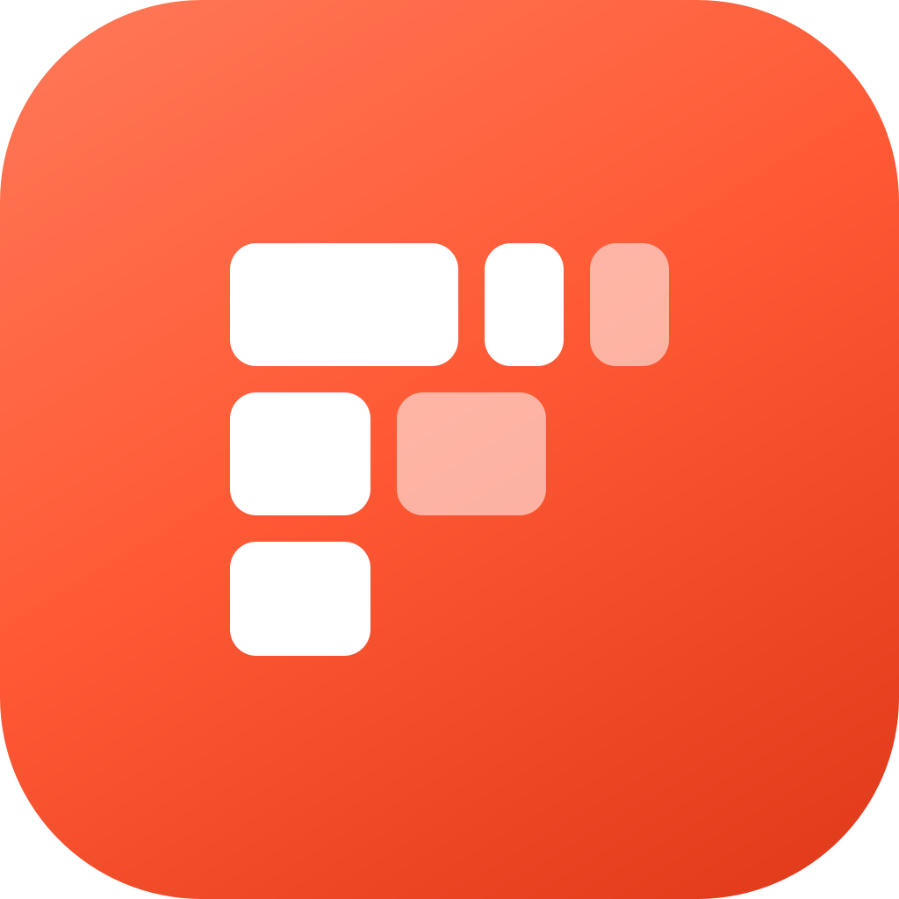

  

# Folio

A fast, open source photo organizer for people who keep their photos in folders.

Folio treats any folder of photos as a library, the way git treats a folder of code. Ratings and labels go into standard XMP sidecars, and what has no other home lives in a hidden `.folio/` folder next to your photos. Open the same folder on another machine and everything is still there. No import, no catalog stored somewhere else, no lock-in.

> Folio is early. It can already sort a folder of date folders into `Category/Outing/` folders with undo (videos included), rate, label and flag photos into XMP sidecars, show a photo large and zoom in with a pinch, show its histogram and metadata, filter and save views, and hand a photo to Affinity. There are no releases yet. To try it on a Mac, run `scripts/bundle-macos.sh` and open `target/release/Folio.app`.

## Why

Photo managers keep your organisation in a catalog that lives outside your photos. Lose the catalog, or export your photos, and the structure is gone. Folio keeps everything with the photos, in plain files you own.

## What it will do

- **Folders first.** Your folders are the structure. Folio reads them as they are.
- **Sort the mess.** Folio groups loose photos into outings and suggests subject folders like `Cities/Stuttgart` or `Projects/Statue`. You review everything on a contact sheet and approve it before any file moves. Every move can be undone.
- **Rate and cull fast.** Star ratings, color labels and pick or reject flags, all from the keyboard.
- **Filter and save views.** Combine rating, keyword, folder, camera, lens and date, then save the result as a view.
- **Hand off to your editor.** Open the selected photos in Affinity with one click.
- **Mac and Windows.** The same library and the same UI on both.

Built in Rust, with a GPU-rendered UI aimed at the snappiness of [Zed](https://zed.dev).

## License

Folio is free software under the [GNU General Public License v3.0 or later](LICENSE). Anyone can use, change and share it. Anyone who distributes Folio or a modified version must also share their source code under the same license, so Folio and every fork stay open source.
